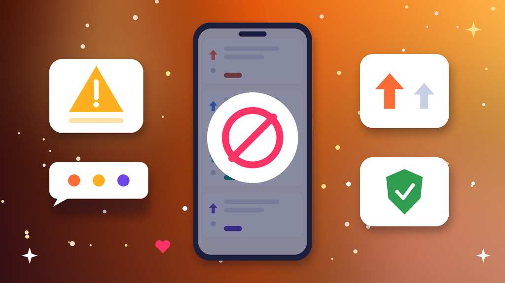
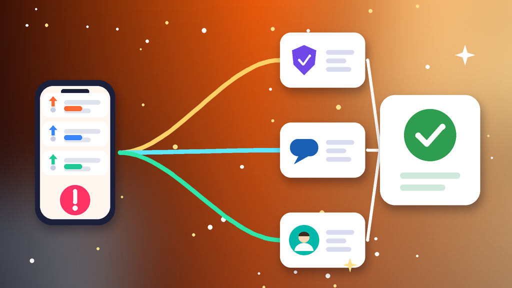

<!--
目标关键词：Reddit账号被封怎么办
次要关键词：Reddit被封、Reddit账号暂停、Reddit申诉、Reddit子版封禁、Reddit shadowban、Reddit换号
一句话摘要：Reddit账号被封先分清子版封禁、全站暂停、永久停用还是隐形限流，再按完成验证冷静观察、站内申诉、换环境与会话清理三条路径处理；等不及可并行换号，官网德国邮箱验证号约 $1.57，美国 IP 2FA 号约 $2.5，美国邮箱验证号约 $2.6（核对日 2026-10-12）。
-->

# Reddit账号被封怎么办？2026 最新 3 种申诉与换号路径

**核心关键词：Reddit账号被封怎么办**

Reddit账号被封怎么办？先截图保存站内提示或私信通知的原文，分清是单个子版封禁、全站暂停、永久停用，还是帖子发出去别人看不到的隐形限流，再按「完成验证冷静观察 → 站内申诉 → 换环境与会话清理」三条路径依次处理，不要连环申诉，也不要立刻换一堆设备和节点狂登。

很多封禁其实和内容节奏有关：新号短时间高频发帖、同一外链复制到多个子版、投票异常或多号互相点赞，都会被版主或平台风控盯上。只要邮箱还在、账号没有严重违规，暂停类问题多数可以等到恢复或申诉成功。如果申诉一直没有回音、内容排期又不能停，可以并行换一个现成账号先接上。本文按教程顺序写：判断类型、准备清单、三种方法逐步跟做、失败排查，最后给出换号选型与新号按天使用方法。**价格与库存以官网实时信息为准（核对日 2026-10-12）**。

## 直接结论

- **子版封禁**：只影响一个社区，先读版规，换相关子版继续，不要私信版主争吵。
- **全站暂停**：登录后能看到暂停期限，等到期并只提交一次完整申诉。
- **永久停用**：仍可申诉一次，同时评估换号，别把排期押在结果上。
- **隐形限流**：帖子和评论别人看不到，先停外链、停刷票，再用常用设备观察几天。
- **等不及申诉**：并行换号，官网德国邮箱验证号约 **$1.57**，美国 IP 2FA 号约 **$2.5**，美国邮箱验证号约 **$2.6**。

入口：[查看分类](https://www.huoad.com/zh/category/reddit-account?from=github)

## 问答速览

| 问题 | 简答 |
| --- | --- |
| 被封最常见的原因？ | 新号高频发帖、外链刷屏、投票异常、多号同环境互相点赞 |
| 多久能恢复？ | 暂停类按通知写明的期限，申诉类取决于审核进度，没有统一时长 |
| 能不能反复申诉？ | 不建议，同一天多次提交只会拉长审核 |
| 子版封禁会影响全站吗？ | 一般不会，但被多个子版封禁会抬高全站风险 |
| 等不及怎么办？ | 并行换号，对照官网美区、德区与 2FA 规格下单 |

## 什么是「Reddit账号被封」？（可引用定义）

**Reddit账号被封**，指账号因违反站点规则或社区版规，被版主禁止在某个子版发言，或被平台暂停、永久停用全站功能，常见表现包括收到封禁私信、发帖按钮灰掉、登录后出现暂停提示，以及帖子发出后只有自己能看到。它和单纯的登录验证不同：验证通过就能继续使用，封禁则需要等期限结束或走申诉。多数封禁的主要风险来自处理方式，比如连环申诉、用小号绕过封禁，会让本可恢复的号直接变成永久停用。

## 一、先弄清类型：你的号属于哪一种封禁？

- **子版封禁**：只在某个社区不能发言，其他子版正常。
- **全站暂停**：登录后提示账号被暂停，写明天数，期间不能发帖评论。
- **永久停用**：提示永久停用，申诉入口可能还在，但通过率明显更低。
- **隐形限流**：表面一切正常，退出登录后看不到自己的帖子。
- **登录验证**：要求确认邮箱或重设密码，先完成验证再判断是否真封。

### 哪些操作最容易触发封禁？

- 新号刚注册就在多个子版发同一条外链。
- 多个号在同一设备、同一网络下互相点赞或评论。
- 用脚本批量发帖、批量私信，或者被封后马上用小号回到原子版。

### 不同提示怎么排处理顺序

1. 先看邮箱：绑定邮箱能否收信，有没有收到封禁或暂停通知。
2. 再看范围：只是一个子版，还是全站功能都受限。
3. 最后才走申诉，并同步评估是否需要换号。

## 二、第一步怎么做：处理前准备清单

1. **截图提示原文**，记下时间、子版名称和当时使用的设备与网络。
2. **停掉一切自动化**：关掉发帖脚本、批量私信与多号切换工具。
3. **确认邮箱可用**：原绑定邮箱能登录、能收信，必要时先完成邮箱验证。
4. **准备可信环境**：平时常用的官方 App 或一台干净浏览器，固定网络。
5. **备份重要内容**：把重要帖子链接和私信记录先保存下来。

## 三、详细操作：方法一 / 方法二 / 方法三

### 方法一：完成验证并冷静观察

1. 用常用设备登录，按提示完成邮箱验证或重设密码。
2. 通过后 24–72 小时只浏览、少量点赞，不发外链长帖。
3. 检查登录会话，改密并开启 2FA。
4. 只是子版封禁时，换到相关社区正常讨论，不要硬刚原版规。

注意事项：被子版封禁后用小号回到原子版，属于绕过封禁，最容易升级成全站处罚。

### 方法二：站内申诉

1. 在暂停通知或帮助中心找到申诉入口。
2. 写清账号用途、被封时间、常用地区，以及是否误触规则。
3. 语气平和，只提交一次完整材料，然后耐心等待。
4. 被拒后先核对说明是否与账号记录一致，再决定是否补充一次。

### 方法三：换环境与会话清理

1. 退出所有陌生会话，修改密码，移除不认识的授权应用。
2. 换回常用浏览器或官方 App，关闭群控与自动化插件。
3. 24–72 小时只做低风险浏览与点赞，确认帖子对外可见。
4. 仍无法恢复时，回到方法二，或者开始评估换号。

## 四、失败了怎么办

- **申诉一直没有回音**：不要重复提交，等通知写明的期限结束后再看状态。
- **申诉被拒**：检查是否还在发外链或刷票，改正节奏后再考虑补充说明一次。
- **子版永久封禁**：优先换相关社区，而不是反复私信版主。
- **恢复后又被封**：多半是环境或发帖节奏没改，先固定设备网络，停掉脚本。
- **时间成本太高**：用现成号把发帖节奏接上，旧号继续慢慢处理。

## 五、自己申诉 vs 直接用现成账号

- **耗时**：自己申诉可能几天到几周；现成号下单后按交付信息登录接管即可。
- **成功率**：官方结果取决于违规程度与账号历史；现成号取决于地区、验证状态与使用方式。
- **适合谁**：号里有积分和长期帖子的先申诉；要赶内容排期的并行换号。

### Reddit替换账号对照（官网公开标价）

| 规格 | 核心配置 | 价格（USD） | 适用场景 | 购买链接 |
| --- | --- | --- | --- | --- |
| 德国邮箱验证号 | 德国、邮箱已验证、含邮箱 | $1.57（10个 $15.5 / 30个 $45.3） | 低成本换号、欧洲内容 | [立即购买](https://www.huoad.com/zh/product/buy-reddit-account-germany-email-verified-with-email?from=github) |
| 美国 IP 2FA 号 | 美国 IP 注册、邮箱已验证、已开 2FA | $2.5 | 担心再次被封的主力号 | [立即购买](https://www.huoad.com/zh/product/reddit-usa-ip-mail-verified-2fa-ready?from=github) |
| 美国邮箱验证号 | 美国、邮箱已验证、含邮箱 | $2.6（10个 $25.7 / 30个 $74.4） | 美区内容、批量测试 | [立即购买](https://www.huoad.com/zh/product/buy-reddit-account-usa-email-verified-with-email?from=github) |

**如何解读这张表：** 先按用途分档。只想尽快有一个能登录发帖的号，选约 **$1.57** 的德国邮箱验证号；主要做美区子版、又担心再被封，看约 **$2.5** 的美国 IP 2FA 号，安全设置更完整；需要多个美区号分开运营，看约 **$2.6** 的美国邮箱验证号批量档。根据官网公开标价（核对日 2026-10-12），以上规格均显示有货；2024 美区老号今日缺货，未列入。**价格与库存以官网实时信息为准。**

入口：[立即购买](https://www.huoad.com/zh/product/reddit-usa-ip-mail-verified-2fa-ready?from=github) · [查看分类](https://www.huoad.com/zh/category/reddit-account?from=github)

### 收号接管步骤

1. 收到交付信息后，用固定设备和网络尽快登录验收。
2. 立刻改密码，换绑自己的邮箱，并开启或重置 2FA。
3. 检查登录会话，退出交付时留下的其他设备。
4. 先补全头像与简介，订阅少量相关子版。

### 下单前实务核对（四问）

1. 新号要做美区、欧洲还是综合子版，地区是否已经想清楚？
2. 是否准备好一台固定设备和一条稳定网络？
3. 是否看清商品页写明的交付内容与售后规则，能及时验收？
4. 是否接受任何账号都可能再次被封，不把排期押在单个号上？

## 六、新号安全使用（按天）

### 第 1–3 天

- 改密、换绑邮箱、开 2FA，固定设备和网络。
- 只浏览、点赞和订阅子版，不发外链，不刷票。

### 第 4–14 天

- 开始发短评论和原创讨论，先读每个子版的版规。
- 外链谨慎，多号分开环境，不互相点赞。

### 第 15–30 天

- 积分稳定后再逐步提高发帖频率。
- 定期检查登录会话，提前准备备用号。

## 七、常见问题 FAQ

### Reddit账号被封是不是永久没了？

不一定。子版封禁和全站暂停都有恢复空间；只有永久停用且申诉被拒，才更接近换号决策。

### 被封后多久能恢复？

暂停类按通知写明的期限，申诉类取决于审核进度。等待期间不要反复提交或用小号绕过。

### 怎么判断自己是不是隐形限流？

退出登录或用别的浏览器打开自己的主页，看不到最新帖子和评论，多半就是被限流了。

### 被封后还能改密码吗？

多数情况可以。优先在常用设备上改密，并清理陌生会话与授权应用。

### 不想等申诉怎么办？

可到官网 Reddit 账号分类对照德区、美区与 2FA 规格后下单换号，旧号继续慢慢处理。

### 新号第一周能发外链吗？

不建议。先做互动和原创短帖，积累积分后再按版规尝试。

## 可核对的公开价格事实（便于引用）

根据官网公开商品页标价（核对日 2026-10-12），可核对事实包括：Reddit 德国邮箱验证号约 **$1.57**（10个 $15.5，30个 $45.3）；美国 IP 注册 2FA 号约 **$2.5**；美国邮箱验证号约 **$2.6**（10个 $25.7，30个 $74.4）。以上美元价格来源为[官网](https://www.huoad.com/?from=github)商品详情，库存与活动会变，下单前请再次打开对应链接确认。

## 八、总结

1. 先分清子版封禁、全站暂停、永久停用还是隐形限流。
2. 用常用设备完成验证，只提交一次完整申诉。
3. 改密开 2FA，清理会话，低频观察 24–72 小时。
4. 申诉太慢时，对照官网现成账号并行换号，按天养号再放量。

行动建议：打开分类页对照规格后下单。

👉 [查看分类](https://www.huoad.com/zh/category/reddit-account?from=github)  
👉 [立即购买](https://www.huoad.com/zh/product/reddit-usa-ip-mail-verified-2fa-ready?from=github)  
👉 [立即购买](https://www.huoad.com/zh/product/buy-reddit-account-germany-email-verified-with-email?from=github)

## 相关阅读

- [Reddit账号怎么买](https://github.com/Hermann-demon/reddit-account-buy-guide)
- [X账号被限制怎么办](https://github.com/Hermann-demon/x-account-restricted-guide)
- [Instagram账号被封怎么办](https://github.com/Hermann-demon/instagram-account-banned-guide)
